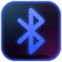
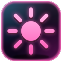
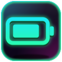
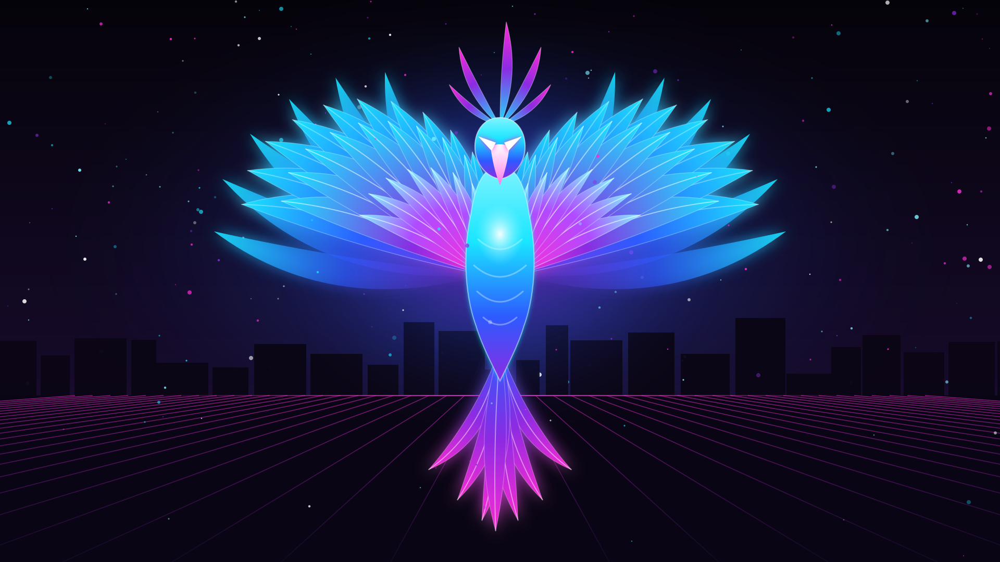
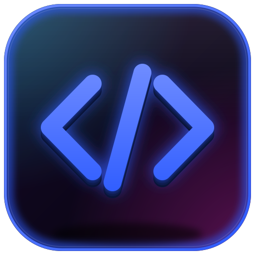
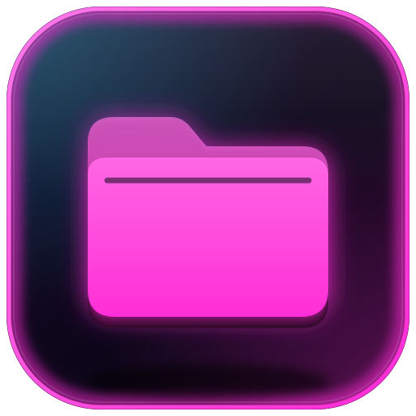
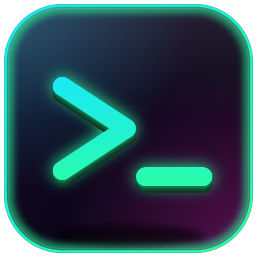
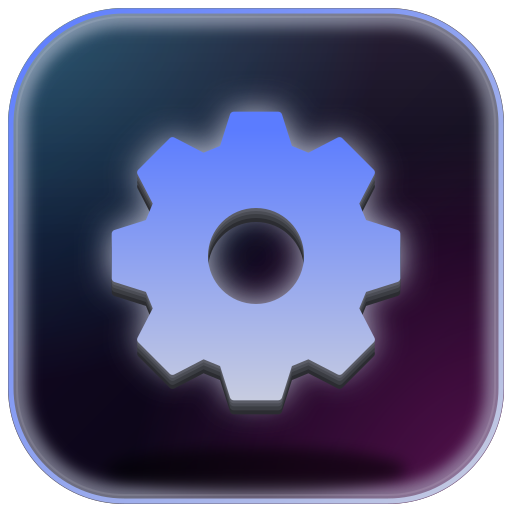
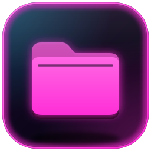
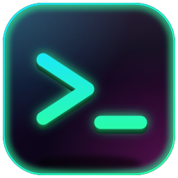

<!-- NARY OS v1.0 · DESKTOP -->

  

<!-- SYSTEM BAR -->
<table width="100%">
  <tr>
    <td align="left"><b>NARY OS</b> &nbsp;·&nbsp; Desktop</td>
    <td align="right">
      &nbsp;
      &nbsp;
      &nbsp;
      &nbsp;
      
    </td>
  </tr>
</table>

<!-- DESKTOP -->

  

<!-- APPLICATIONS -->
<table align="center">
  <tr>
    <td align="center"><a href="apps/about.md"> <b>About Me</b></a></td>
    <td align="center"><a href="apps/dev-studio.md"> <b>Dev Studio</b></a></td>
    <td align="center"><a href="apps/projects.md"> <b>Projects</b></a></td>
    <td align="center"><a href="apps/terminal.md"> <b>Terminal</b></a></td>
  </tr>
</table>
<table align="center">
  <tr>
    <td align="center"><a href="apps/education.md"> <b>Education</b></a></td>
    <td align="center"><a href="apps/contact.md"> <b>Contact</b></a></td>
    <td align="center"><a href="apps/settings.md"> <b>Settings</b></a></td>
  </tr>
</table>

<!-- IDENTITY -->

  <b>N A R Y &nbsp; O S</b> 
  <i>Samy nosorandreniny Token ka aza mifampidera produit</i>

<!-- DOCK -->
<table align="center">
  <tr>
    <td align="center"></td>
    <td align="center"></td>
    <td align="center"></td>
    <td align="center"></td>
  </tr>
</table>

<!-- SYSTEM SIGNATURE -->

  <i>Samy nosorandreniny Token ka aza mifampidera produit</i> 
  NARY OS v1.0 — Your workspace. Your identity. Your system.

