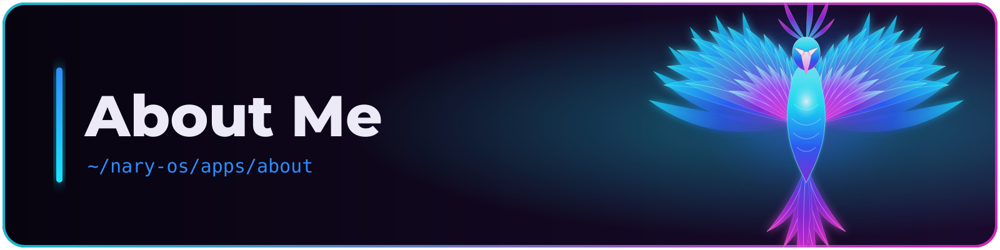

<!-- NARY OS · HEADER -->
<table width="100%">
  <tr>
    <td align="left"><a href="../README.md">← Back</a> &nbsp;·&nbsp; <a href="../README.md"> Home</a></td>
    <td align="right">NARY OS v1.0</td>
  </tr>
</table>

# About Me

`~/nary-os/apps/about`

## Profil

| | |
|---|---|
| **Nom** | Tsiresy |
| **Pseudo** | Nary |
| **Localisation** | Antananarivo, Madagascar |
| **Langues** | Français · Russe (j'apprends et j'enseigne en peer-to-peer) |
| **Statut** | Développeur, passionné de systèmes, de jeux et de créations originales |

## Parcours

Mon terrain de jeu, c'est le **développement logiciel et l'administration système** : Linux, scripts Python, projets de la formation École 42 (machines virtuelles Debian, durcissement SSH, scripts de monitoring). À côté, je construis des projets personnels : un jeu d'enquête Android, un pipeline d'extraction de texte pour la traduction de manhwa, un bureau Linux au thème kawaii, une plateforme d'apprentissage du russe.

Je travaille beaucoup depuis un **téléphone Android avec Termux**, ce qui m'oblige à écrire des outils légers, robustes et sans dépendances inutiles.

## Ce que j'aime

- **Linux et la personnalisation de bureau** : thèmes, widgets, outils système.
- **Le jeu vidéo** et ses outils (animation de sprites, moteurs de jeu).
- **L'anime et le webtoon** : je développe un webtoon original de dark fantasy.
- **Les langues** : j'étudie le russe et je le transmets.

## Navigation

[Dev Studio](dev-studio.md) · [Projects](projects.md) · [Education](education.md) · [Contact](contact.md)

<!-- À compléter : parcours détaillé, objectifs. -->

---

<!-- NARY OS · FOOTER -->

  <i>Samy nosorandreniny Token ka aza mifampidera produit</i> 
  NARY OS v1.0 — Your workspace. Your identity. Your system.

