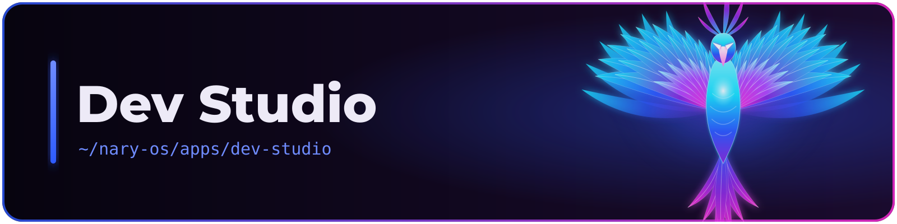

<!-- NARY OS · HEADER -->
<table width="100%">
  <tr>
    <td align="left"><a href="../README.md">← Back</a> &nbsp;·&nbsp; <a href="../README.md"> Home</a></td>
    <td align="right">NARY OS v1.0</td>
  </tr>
</table>

# Dev Studio

`~/nary-os/apps/dev-studio`

## Langages

| Langage | Utilisé pour |
|---|---|
| **Python** | Outils système, widgets de bureau (PyQt6, tkinter), dashboard terminal (curses), pipeline OCR, scripts d'automatisation |
| **JavaScript / TypeScript** | Sites web, interfaces, logique de jeu (Next.js, React) |
| **Shell / Bash** | Scripts Linux, monitoring, utilitaires réseau |
| **HTML / CSS** | Interfaces, pages statiques, Markdown avancé |
| **Java (Sketchware)** | Application Android *Case Zero* |

## Frameworks et technologies

| Domaine | Technologies |
|---|---|
| **Web** | Next.js, React, TypeScript, Vercel |
| **Base de données** | PostgreSQL, Drizzle ORM |
| **Desktop Linux** | GNOME / X11, PyQt6, wmctrl / xprop |
| **Android** | Sketchware, WebView, Termux |
| **OCR / vision** | Tesseract, extraction multi-modèles |

## Systèmes et sécurité

- Linux : Debian, Ubuntu (GNOME, thèmes Catppuccin, icônes Papirus).
- Durcissement : SSH, politiques sudo, PAM, AppArmor, Fail2ban, LVM chiffré.
- Réseau : partage de connexion Wi-Fi, outils de diagnostic.

## Outils

- **Git / GitHub** pour le versionnement.
- **Termux** comme environnement de développement mobile.
- **Node.js** et **esbuild** pour les tests.
- **Assistants IA** pour accélérer la conception, l'écriture et la relecture.

## Projets liés

Retrouve les réalisations dans [Projects](projects.md).

---

<!-- NARY OS · FOOTER -->

  <i>Samy nosorandreniny Token ka aza mifampidera produit</i> 
  NARY OS v1.0 — Your workspace. Your identity. Your system.

