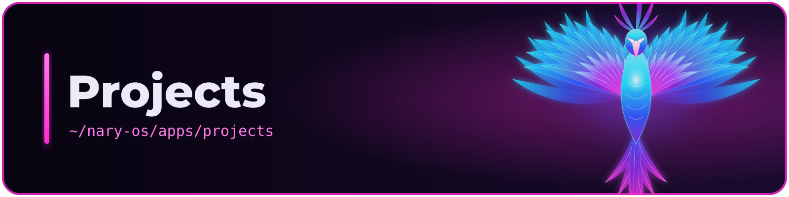
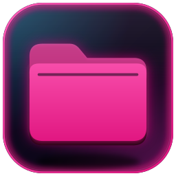

<!-- NARY OS · HEADER -->
<table width="100%">
  <tr>
    <td align="left"><a href="../README.md">← Back</a> &nbsp;·&nbsp; <a href="../README.md"> Home</a></td>
    <td align="right">NARY OS v1.0</td>
  </tr>
</table>

# Projects

`~/nary-os/apps/projects`

## Fiches détaillées

<table>
  <tr>
    <td align="center"><a href="../projects/case-zero.md"> <b>Case Zero</b></a></td>
    <td align="center"><a href="../projects/nary-translator.md"> <b>Nary-Translator</b></a></td>
    <td align="center"><a href="../projects/wordprofessional.md"> <b>WordProfessional</b></a></td>
    <td align="center"><a href="../projects/nary-os.md"> <b>NARY OS</b></a></td>
  </tr>
</table>

| Projet | Description | Statut |
|---|---|---|
| [Case Zero](../projects/case-zero.md) | Jeu d'enquête Android (Sketchware) | En développement |
| [Nary-Translator](../projects/nary-translator.md) | Pipeline Termux : téléchargement, OCR, texte structuré | En développement |
| [WordProfessional](../projects/wordprofessional.md) | *(à compléter)* | *(à compléter)* |
| [NARY OS](../projects/nary-os.md) | Ce bureau : un système d'exploitation dans un README | v1.0 |

## Autres réalisations

| Projet | Description |
|---|---|
| **NaryDesktop** | Suite de bureau Linux au thème kawaii : widgets Python flottants, mascotte animée, dashboard terminal |
| **Nary Shield** | Extension Brave complétant EasyList / EasyPrivacy |
| **Russian Academy** | Plateforme web d'apprentissage du russe pour francophones (Next.js) |
| **Git Battle Simulator** | Jeu de simulation pour apprendre Git (React) |
| **NARY STUDIO** | Court-métrage en Unicode Braille diffusé dans un terminal |
| **SENKŌRAN — Dredgeborn** | Webtoon et univers de dark fantasy original |

## Dépôts GitHub

Tous les dépôts publics : [github.com/Nary-Phenix](https://github.com/Nary-Phenix?tab=repositories).

---

<!-- NARY OS · FOOTER -->

  <i>Samy nosorandreniny Token ka aza mifampidera produit</i> 
  NARY OS v1.0 — Your workspace. Your identity. Your system.

