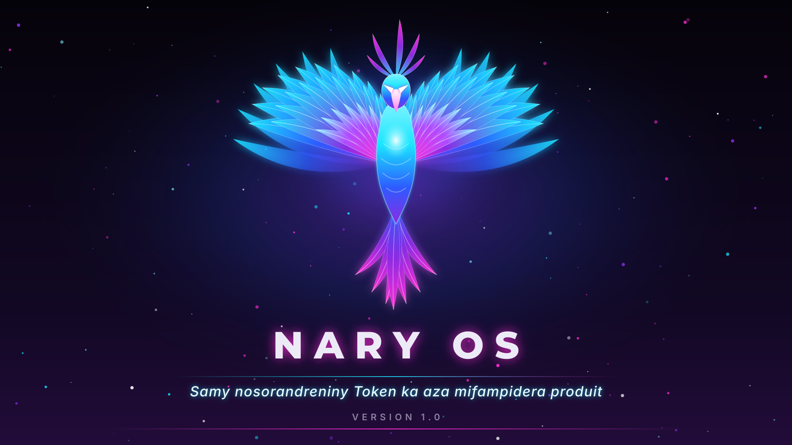

<!-- NARY OS · HEADER -->
<table width="100%">
  <tr>
    <td align="left"><a href="../desktop.md">← Back</a> &nbsp;·&nbsp; <a href="../desktop.md"> Home</a></td>
    <td align="right">NARY OS v1.0</td>
  </tr>
</table>

# Settings

`~/nary-os/apps/settings`

 

## À propos du système

| | |
|---|---|
| **Système** | NARY OS |
| **Version** | 1.0 |
| **Thème** | Cyberpunk / Premium Dark |
| **Type** | GitHub Profile README Operating System Simulation |
| **Navigation** | Markdown multipage |
| **Mascotte** | Phoenix |

## Écran de verrouillage

  

## Slogan officiel

> *Samy nosorandreniny Token ka aza mifampidera produit*

## Palette

| Rôle | Couleur |
|---|---|
| Fond | `#05030A` · `#1A0B2E` |
| Magenta | `#FF2BD6` |
| Violet | `#8B2BE2` |
| Cyan | `#19E6FF` |
| Bleu électrique | `#2D5BFF` |

## Documentation technique

[Spécification](../docs/SPECIFICATION.md) · [Architecture](../docs/ARCHITECTURE.md) · [Roadmap](../docs/ROADMAP.md)

## Crédits

- **Conception, direction artistique et identité** : Tsiresy (Nary).
- **Assets graphiques** : générés en SVG puis exportés en PNG/GIF (sources dans `image/src/`).
- **Réalisation** : développé avec l'aide de Claude (Anthropic).

---

<!-- NARY OS · FOOTER -->

  <i>Samy nosorandreniny Token ka aza mifampidera produit</i> 
  NARY OS v1.0 — Your workspace. Your identity. Your system.

