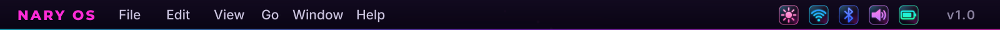
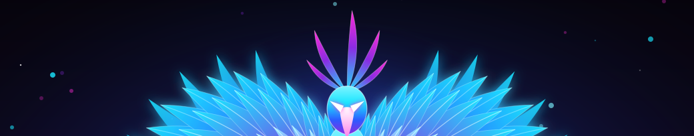
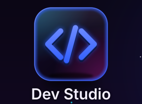
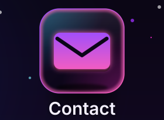
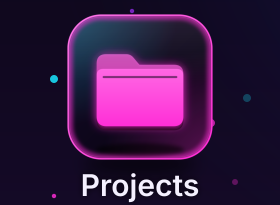
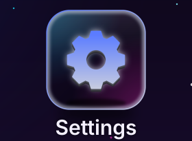
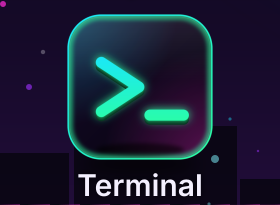
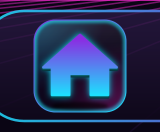
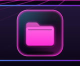
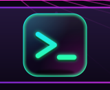

<!-- NARY OS v1.0 · DESKTOP (écran principal) -->

<!-- DESKTOP:START -->

 
 
 
 
 

<!-- DESKTOP:END -->

<!-- QUICK LINKS -->

  
    <a href="apps/about.md">About Me</a> · <a href="apps/dev-studio.md">Dev Studio</a> · <a href="apps/projects.md">Projects</a> · <a href="apps/terminal.md">Terminal</a> · <a href="apps/education.md">Education</a> · <a href="apps/contact.md">Contact</a> · <a href="apps/settings.md">Settings</a>
  

<!-- LOCK -->

  <a href="README.md">Verrouiller la session</a>

<!-- SYSTEM SIGNATURE -->

  <i>Samy nosorandreniny Token ka aza mifampidera produit</i> 
  NARY OS v1.0 — Your workspace. Your identity. Your system.

