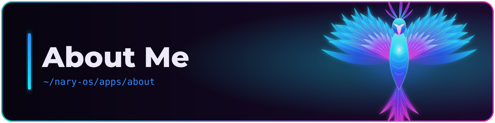

# NARY OS — Architecture & conventions

**Version du document :** 1.0 (Phase 1 — Foundation)

---

## 1. Arborescence

```
Nary-Phenix/
├── README.md                 # Écran de verrouillage (boot.gif cliquable)
├── desktop.md                # Bureau (écran principal)
├── image/
│   ├── wallpaper.png         # fond du bureau
│   ├── lockscreen.png        # écran de verrouillage
│   ├── phoenix_logo.png
│   ├── boot.gif
│   ├── ic_about.png          # icônes d'applications (7)
│   ├── ic_devstudio.png
│   ├── ic_projects.png
│   ├── ic_terminal.png
│   ├── ic_education.png
│   ├── ic_contact.png
│   ├── ic_settings.png
│   ├── ic_folder.png         # icônes système
│   ├── ic_file.png
│   ├── ic_github.png
│   ├── ic_home.png
│   ├── ic_wifi.png           # barre système
│   ├── ic_bluetooth.png
│   ├── ic_battery.png
│   ├── ic_volume.png
│   ├── ic_brightness.png
│   ├── desktop/              # tranches du bureau (générées, voir §5)
│   ├── dock/
│   │   ├── dock_home.png
│   │   ├── dock_projects.png
│   │   ├── dock_terminal.png
│   │   └── dock_contact.png
│   ├── banners/
│   │   ├── banner_about.png
│   │   ├── banner_projects.png
│   │   └── banner_devstudio.png
│   ├── README.md             # index des assets + procédure de remplacement
│   └── src/                  # sources SVG + scripts de régénération (build.py)
├── apps/
│   ├── about.md
│   ├── dev-studio.md
│   ├── projects.md
│   ├── terminal.md
│   ├── education.md
│   ├── contact.md
│   └── settings.md
├── projects/
│   ├── case-zero.md
│   ├── nary-translator.md
│   ├── wordprofessional.md
│   └── nary-os.md
└── docs/
    ├── SPECIFICATION.md
    ├── ARCHITECTURE.md
    └── ROADMAP.md
```

Les dossiers vides contiennent un `.gitkeep` (Git ne suit pas les dossiers vides). Les retirer quand un vrai fichier est ajouté.

---

## 2. Conventions de nommage

| Élément | Règle | Exemple |
|---|---|---|
| Pages Markdown | `kebab-case.md`, minuscules | `dev-studio.md` |
| Icônes d'applications / système / barre système | `ic_<nom>.png`, minuscules, sans tiret | `ic_devstudio.png` |
| Dock | `dock/dock_<nom>.png` | `dock_home.png` |
| Bannières | `banners/banner_<app>.png` | `banner_about.png` |
| Sources vectorielles | `src/<nom>.svg`, même nom que l'export | `src/ic_about.svg` |
| Docs | `MAJUSCULES.md` | `ROADMAP.md` |

Règles générales : pas d'espaces, pas d'accents, pas de majuscules dans les chemins d'images (GitHub est sensible à la casse).

---

## 3. Liens et chemins

- **Tous les liens et images sont relatifs.** Aucun lien absolu vers `github.com/.../blob/...`, sauf pour les dépôts de projets.
- Depuis `README.md` et `desktop.md` : `apps/about.md`, `image/ic_about.png`.
- Depuis `apps/*.md` : `../desktop.md` (Home et Back), `../image/ic_about.png`.
- Depuis `projects/*.md` : `../desktop.md`, `../apps/projects.md`, `../image/...`.
- Un seul `README.md` est rendu sur le profil ; les pages `apps/` et `projects/` s'ouvrent comme des fichiers Markdown rendus.
- Lien vers un dépôt réel : URL complète `https://github.com/<utilisateur>/<repo>`.

> ⚠️ **Point d'attention :** pour qu'un README s'affiche sur le profil GitHub, il doit se trouver à la racine d'un dépôt nommé exactement `<nom-d-utilisateur>/<nom-d-utilisateur>`. `Nary-Phenix` est le nom du dossier de travail ; le dépôt final devra porter le nom d'utilisateur GitHub (le contenu reste identique).

---

## 4. Template commun des applications

Chaque page `apps/*.md` suit cette structure (finalisée en Phase 4) :

```markdown
<!-- NARY OS · HEADER -->
<table width="100%"><tr>
<td align="left"><a href="../desktop.md">← Back</a> · <a href="../desktop.md"> Home</a></td>
<td align="right"><sub>NARY OS v1.0</sub></td>
</tr></table>



# About Me
`~/nary-os/apps/about`

<!-- CONTENU SPÉCIFIQUE -->

---
<!-- NARY OS · FOOTER -->
<p align="center"><sub><i>Samy nosorandreniny Token ka aza mifampidera produit</i><br>NARY OS v1.0 — Your workspace. Your identity. Your system.</sub></p>
```

Éléments obligatoires : Back, Home, header, titre, chemin virtuel (`~/nary-os/apps/<app>`), contenu, footer avec slogan exact.
Fiches projets : même structure + section **Repository** avec lien GitHub réel ; Back → `../apps/projects.md`.

---

## 5. Deux écrans : verrouillage et bureau (README.md + desktop.md)

GitHub interdit tout positionnement et toute superposition. Le contournement est de **séparer en deux pages**, exactement comme les applications :

1. **`README.md` = écran de verrouillage.** Il affiche `boot.gif` (qui se termine sur le lockscreen), cliquable : un clic ouvre `desktop.md`. Un lien texte « Cliquer pour déverrouiller » et la signature système (slogan) complètent la page.
2. **`desktop.md` = bureau.** Une seule scène (barre de menu, Phoenix, titre et slogan, 7 icônes de bureau, dock) dessinée en 1600×1000 puis **découpée en 18 tranches** (`image/desktop/`) : images en ligne sans espace entre les balises, largeurs en % dont la somme fait 100 %, donc recollées en une image continue sur toute largeur d'écran. Chaque tranche portant une icône est liée à son application. Le bloc est généré entre `<!-- DESKTOP:START -->` et `<!-- DESKTOP:END -->` (ne pas le modifier à la main : `python3 image/src/build.py desktop` le réécrit).
3. **Applications.** Home et Back ramènent à `desktop.md`. Un lien « Verrouiller la session » sous le bureau ramène à `README.md`.

Parcours : `README.md` (verrouillé) → `desktop.md` (bureau) → `apps/*.md` → `projects/*.md`.

Disposition du bureau : barre de menu (48 px) ; About Me, Dev Studio, Projects, Terminal à gauche ; Education, Contact, Settings à droite ; Phoenix, « NARY OS » et slogan au centre ; dock de 4 icônes en bas. Sous le bureau : une ligne de liens texte (lisible sur mobile) et la signature.

> **Important :** le README de profil GitHub est l'écran de verrouillage ; le bureau est donc une page de plus à un clic, pas affiché d'emblée. Ce choix remplace l'exigence initiale « découvrir directement un bureau » : c'est le contournement validé le 2026-11-19 pour obtenir une vraie impression de PC.

---

## 6. Règles de rendu GitHub et mobile

- Balises sûres : `table/tr/td`, `a`, `img` (`width`, `height`, `alt`, `align`), `picture`, `br`, `b`, `i`, `sub`, `sup`, `details/summary`, `p align`.
- Interdit : `style`, `class`, `script`, `iframe`, `svg` inline, `position`, `background`.
- Largeur utile du README GitHub ≈ 830–900 px sur ordinateur, ≈ 340–390 px sur mobile.
- **Bureau en tranches :** largeurs en %, somme exacte de 100 % par ligne, aucune espace entre les images d'une ligne. Les icônes de bureau mesurent environ 33 px sur un téléphone de 390 px (88 px sur ordinateur) ; la ligne de liens rapides compense la lisibilité des libellés.
- Toujours définir `width` sur chaque image (évite les sauts de mise en page) et un `alt` descriptif.
- **Fond clair de GitHub :** les icônes sont livrées **opaques sur tuile sombre** (coins arrondis) pour que le glow reste lisible en thème clair. Pas de PNG transparent avec glow nu (rendu délavé sur blanc, comme dans la référence du dossier néon).
- Les GIF se lisent automatiquement en boucle ; boot.gif est exporté avec **boucle = 1** pour se figer sur la dernière image.
- Tous les assets sont versionnés dans le dépôt (aucune dépendance à un service externe).

---

## 7. Palette

| Rôle | Nom | Hex |
|---|---|---|
| Fond principal | Void | `#05030A` |
| Surface profonde | Deep Violet | `#1A0B2E` |
| Surface fenêtre | Panel | `#120A1F` |
| Bordure / séparateur | Edge | `#2A1B45` |
| Accent principal | Magenta | `#FF2BD6` |
| Accent dossier (réf.) | Hot Pink | `#E0147F` |
| Accent secondaire | Violet | `#8B2BE2` |
| Accent froid | Cyan | `#19E6FF` |
| Accent froid profond | Electric Blue | `#2D5BFF` |
| Terminal | Neon Green | `#2BFFA0` |
| Neutre métal | Silver | `#C7CCE0` |
| Texte principal | Ghost | `#EDEAF7` |
| Texte secondaire | Muted | `#8A829F` |

Flammes du Phoenix : dégradé `#19E6FF` → `#2D5BFF` → `#8B2BE2` (avec touches `#FF2BD6` limitées).

**Couleurs par application** (couleur de glow → couleur de reflet) :

| Icône | Glow | Reflet |
|---|---|---|
| `ic_about` | `#19E6FF` | `#2D8CFF` |
| `ic_devstudio` | `#2D5BFF` | `#6F8CFF` |
| `ic_projects` | `#FF2BD6` | `#FF7AE8` |
| `ic_terminal` | `#2BFFA0` | `#19E6FF` |
| `ic_education` | `#8B2BE2` | `#B87CFF` |
| `ic_contact` | `#FF5FB8` | `#9B4DFF` |
| `ic_settings` | `#C7CCE0` | `#5B7CFF` |

---

## 8. Spécifications des assets

| Fichier | Dimensions source | Affichage | Format | Budget |
|---|---|---|---|---|
| `wallpaper.png` | 1920×1080 (16:9) | 100 % | PNG | ≤ 1,5 Mo |
| `lockscreen.png` | 1920×1080 (16:9) | 100 % | PNG | ≤ 1,5 Mo |
| `phoenix_logo.png` | 1024×1024, fond transparent | 160–240 px | PNG | ≤ 700 Ko |
| `boot.gif` | 960×540, 10–12 i/s, 6–8 s, boucle 1 | 100 % | GIF | ≤ 4 Mo |
| `ic_about … ic_settings` (7) | 512×512, tuile opaque, rayon ≈ 22 % | 88 px | PNG | ≤ 160 Ko chacune |
| `ic_folder, ic_file, ic_github, ic_home` | 256×256, tuile opaque | 24–48 px | PNG | ≤ 60 Ko |
| `ic_wifi, ic_bluetooth, ic_battery, ic_volume, ic_brightness` | 128×128, tuile opaque | 20 px | PNG | ≤ 20 Ko |
| `dock/dock_*.png` (4) | 256×256, tuile opaque | 56 px | PNG | ≤ 60 Ko |
| `banners/banner_*.png` (3) | 1600×400 (4:1) | 100 % | PNG ou WebP | ≤ 400 Ko |
| `desktop/desk_*.png` (18) | tranches d'une scène 1600×1000 | 100 % (en tranches) | PNG | ≈ 700 Ko au total |

Les budgets des icônes ont été relevés (palette réduite = dégradés et glows abîmés). Budget total des images : **≈ 12 Mo maximum** (actuellement ≈ 5 Mo), pour un chargement rapide sur mobile.

**Marges de sécurité :** le sujet reste à l'intérieur de 90 % de la zone ; sur `wallpaper.png`, le Phoenix et le slogan restent dans le tiers central (pour supporter un recadrage mobile).

### Style des icônes (guide)

- Même source lumineuse (en haut à gauche), même perspective, même rayon d'angle.
- Corps « verre sombre » (intérieur noir/violet profond) + liseré néon de la couleur d'identité + glow externe doux, comme le dossier néon de référence, avec le relief 3D des dossiers de la capture « Files ».
- Pictogramme simple au centre, lisible à 24 px : About = silhouette de profil, Dev Studio = chevrons `</>`, Projects = dossier, Terminal = invite `>_`, Education = toque/livre, Contact = enveloppe/@, Settings = engrenage.
- Pas de texte dans les icônes.

---

## 9. Choix validés (2026-11-18)

1. **Ajout de `image/src/`** pour conserver les sources SVG (les PNG sont des exports). Non prévu dans l'arborescence d'origine.
2. **Icône Back :** l'arborescence ne contient pas `ic_back.png` ; en attendant, Back est un lien texte `← Back`. Proposition : ajouter `ic_back.png` (128×128).
3. **Rôle du lockscreen :** utilisé comme visuel de la page Settings et comme dernier fond du boot, pas comme écran intermédiaire (un écran de plus avant le bureau contredirait « découvrir directement un bureau »).
4. **boot.gif en tête de README**, bref (6–8 s) et figé sur le bureau, avec le vrai bureau cliquable juste dessous.
